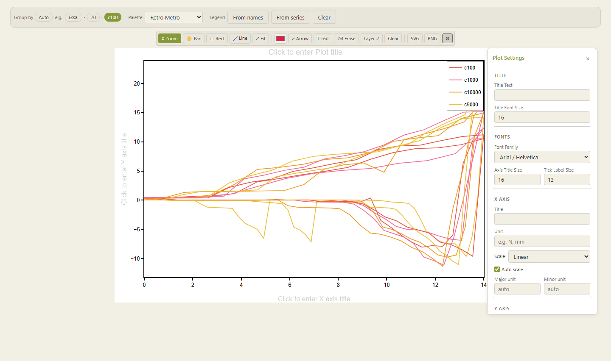

# Plotter — open, AI-drivable analysis layer for laboratory data

**Plotter** turns raw instrument exports into processed curves, extracted metrics and
population statistics — from a web browser for the scientist, **or from an AI agent**
through a built-in [Model Context Protocol](https://modelcontextprotocol.io) (MCP) server.

It is developed at **Materia Nova** (surface treatment & coatings R&D) as one building block
of a broader effort to retrofit existing laboratory equipment with open, vendor-neutral
software, so that experiments can be executed, recorded, analysed and archived in a single,
reproducible loop — and, ultimately, planned and steered by AI with a human in the loop.

> **Horizon Europe context** — this repository is part of Materia Nova's showcase for
> *HORIZON-RAISE-2027-01-01 — Automated Scientific Discovery (RAISE pilot)*.
> See **[docs/RAISE_alignment.md](docs/RAISE_alignment.md)** for how it maps onto the call
> and **[docs/ROADMAP.md](docs/ROADMAP.md)** for what comes next.



## What it does

| Step | Capability | Where |
|------|-----------|-------|
| **Ingest** | CSV / TXT / TSV with automatic delimiter, header and units-line detection; Excel (`.xlsx`, `.xls`). Works with heterogeneous instrument exports (potentiostat, tribometer, UV-vis, XRD…) without per-instrument code. | `web/backend/core/data_loader.py` |
| **Process** | Smoothing, outlier removal, denoising (Savitzky-Golay, median, wavelet, FFT low-pass), baseline correction (SNIP, AsLS, arPLS, masked polynomial, auto), normalisation. Applied on the read path, non-destructive. | `web/backend/core/processing.py`, `denoise_methods.py`, `baseline_correction.py` |
| **Analyse** | Per-file metric extraction (max, min, slope, value at X, Y at max X, conditional values…) and **population statistics** (n, mean, sample SD, CV %) grouped by filename tokens. | `web/backend/core/extraction.py`, `web/frontend/src/utils/stats.ts` |
| **Store & share** | Each analysis session is a self-contained, documented SQLite pool (`.db`): raw data, processing settings, extracted values and plot style — reopenable and shareable. | `web/backend/core/db_schema.py` |
| **Supervise** | Interactive Plotly UI with step-by-step tutorial, publication-grade SVG/PNG export, annotation layer. | `web/frontend/` |
| **Automate** | MCP server: an LLM agent can list, open, describe, plot, extract, compute statistics and save — using the **same code path** as the UI. | `web/backend/mcp_server.py` |

## AI-ready: the MCP interface

The backend mounts an MCP server at `/mcp` (streamable HTTP). Nothing needs to be installed on
the client side; e.g. with Claude Code:

```
claude mcp add --transport http plotter http://<server>/plotter/mcp
```

Exposed tools: `list_share`, `open_files`, `session`, `describe`, `plot` (returns an image and
a numeric summary), `extract`, `stats`, `save`.

Design principles relevant to trustworthy automation:

- **One code path** — MCP tools call the existing API route handlers; an agent cannot
  obtain a result the scientist could not reproduce in the UI.
- **Human-verifiable output** — the agent's work is saved as a pool `.db` that the scientist
  reopens in the browser to inspect every curve, setting and extracted value.
- **Controlled data entry** — the agent only sees files placed in a dedicated shared folder
  (`SHARE_PATH`), never the users' disks.
- The MCP endpoint is currently **unauthenticated** and meant for a trusted LAN
  (see [ROADMAP](docs/ROADMAP.md)).

## Quick start (dev)

```powershell
# Prerequisites (once)
cd web\frontend; npm install
cd ..\backend;  python -m venv venv_win; .\venv_win\Scripts\Activate.ps1
pip install -r requirements.txt -r requirements-dev.txt

# Run backend (9099) + Vite (5174) and open the browser
cd web
.\start-plotter.ps1
```

→ http://localhost:5174

**Stack**: FastAPI (Python 3.12, pandas, NumPy, SciPy, PyWavelets) + React 19 / TypeScript /
Vite / Zustand / Plotly.js. Multi-tenant: one isolated state per browser session, persisted
as `<sid>.db`.

## Repository layout

```
web/backend/    FastAPI: api/ (routers), core/ (processing), models/ (schemas), main.py, mcp_server.py
web/frontend/   React/Vite: src/components, src/store (Zustand), src/api
web/deploy/     Deployment scripts (Windows service via NSSM, nginx sub-path, promotion dev→beta→prod)
tests/          Backend tests (pytest)
docs/           Technical notes; docs/legacy/ = archived desktop app documentation
```

A former PyQt5 desktop version is archived under the git tag `legacy-desktop-2026-06-21`.

## Tests & quality

```powershell
python -m pytest                       # backend, from repo root
cd web\frontend; npm test              # frontend (Vitest: store + statistics)
cd web\backend; ruff check .; black .  # lint/format (config in pyproject.toml)
cd web\frontend; npm run lint          # ESLint
```

## Documentation

- **[ARCHITECTURE.md](ARCHITECTURE.md)** — architecture overview (FR)
- **[PITFALLS.md](PITFALLS.md)** — known pitfalls and their fixes (FR/EN)
- **[web/deploy/DEPLOY.md](web/deploy/DEPLOY.md)** — deployment (nginx, Windows services) (FR)
- **[docs/](docs/)** — denoising, baseline correction, performance notes

## Releases

Semantic versioning (`vX.Y.Z`); source of truth is `FastAPI(version=...)` in
`web/backend/main.py`.

## License

**To be confirmed by Materia Nova** (candidates: Apache-2.0 or EUPL-1.2). Until a `LICENSE`
file is added, all rights are reserved.

## Contact

Materia Nova — <https://www.materianova.be>
