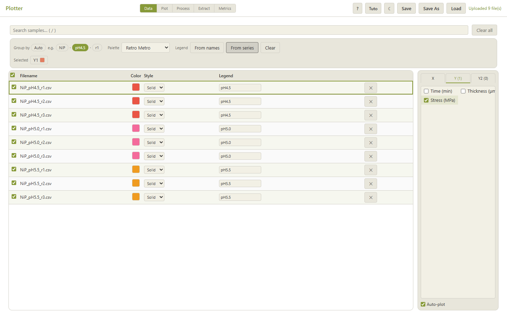
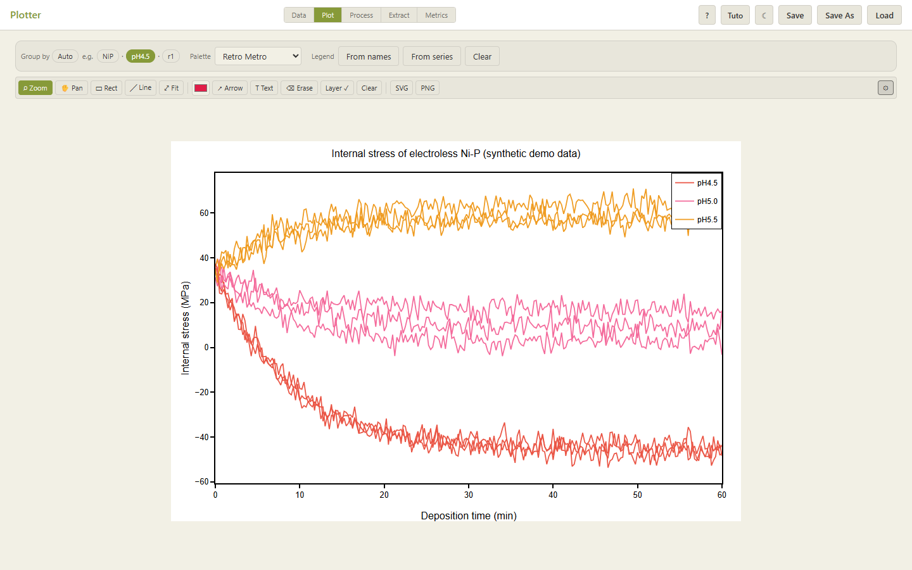
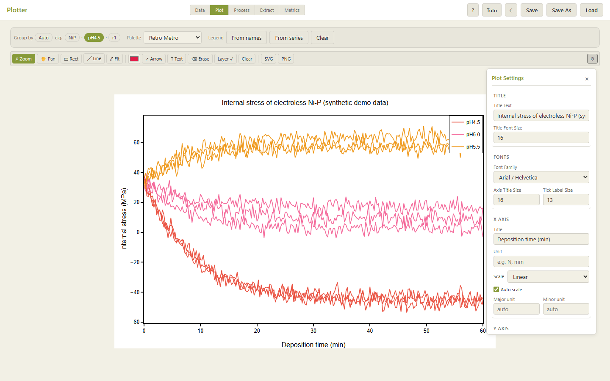
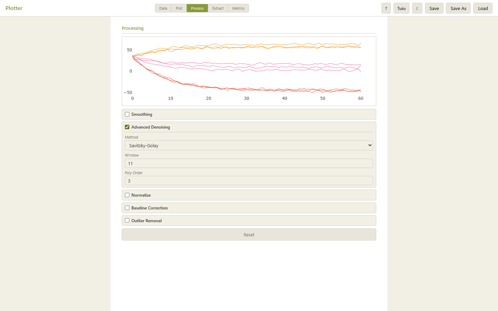
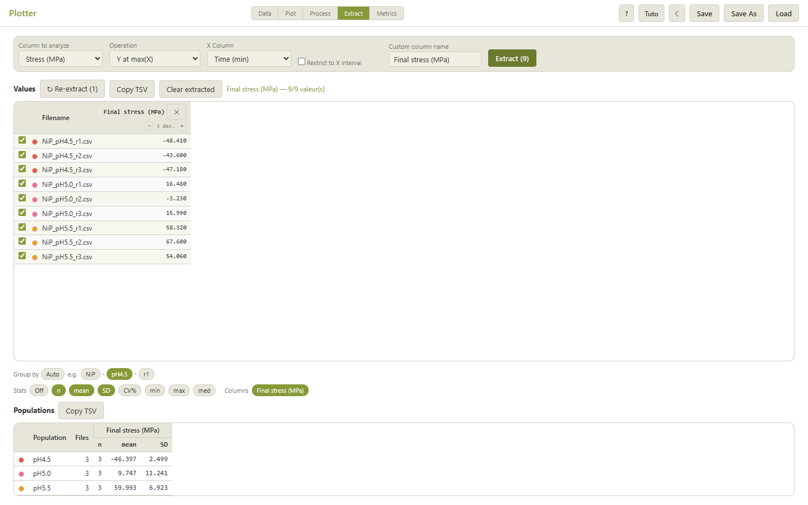
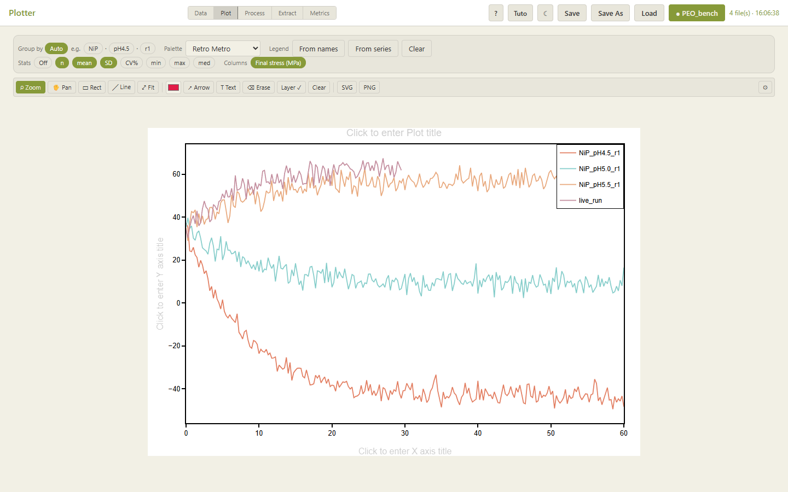
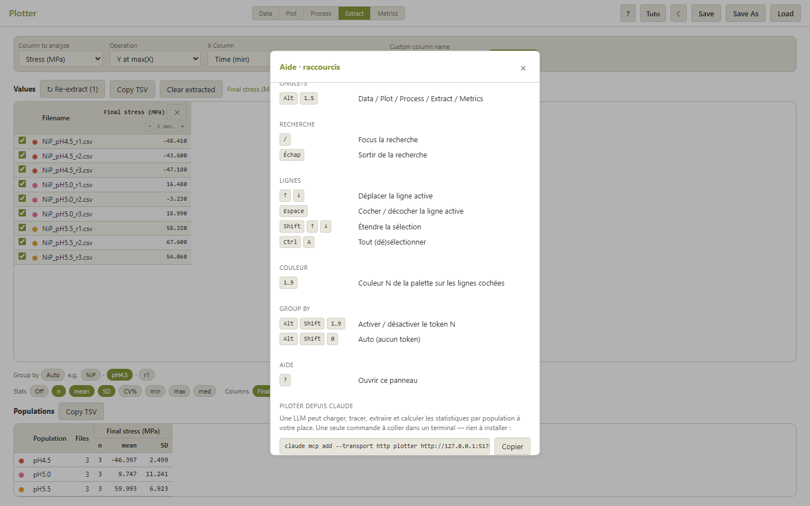

# Plotter in pictures

A guided tour of Plotter on a **synthetic** demo dataset: the internal stress of electroless
Ni-P deposits measured at three bath pH values, with three replicates each. The data are
illustrative, generated by [`examples/make_demo_data.py`](../examples/make_demo_data.py),
not measured. The screenshots are regenerated by
[`web/frontend/scripts/capture-showcase.mjs`](../web/frontend/scripts/capture-showcase.mjs), and
the folder-watch screenshot by the end-to-end test
[`e2e-watch.mjs`](../web/frontend/scripts/e2e-watch.mjs).

## Why one central tool for everyone's figures

In many labs, every scientist turns raw instrument exports into figures their own way: an
Excel template, a personal script, the vendor's software. The same measurement then ends up
with different processing, different fonts and colours, and statistics that nobody can trace
back. Plotter replaces this with **one shared web application** on the lab network:

| Benefit | How |
|---|---|
| **Nothing to install** | A server on the lab network; users just open a URL. Updates reach everyone at once. |
| **Uniform figure formatting** | One "academic publication" default style (white background, closed frame, outward ticks, no grid, Arial). Fonts, axes, legend and size are set in one panel and can be saved as a **preset (`.json`)** shared across the team, so every report and paper figure from the lab looks the same. |
| **Same processing for everyone** | Smoothing, denoising, baseline correction and normalisation come from one implementation with documented parameters, so two people processing the same file get the same curve. |
| **Comparable statistics** | Populations, mean, sample standard deviation and CV % are computed the same way for every user, directly from the file names. No manual copy-paste into a spreadsheet. |
| **Reproducible, shareable results** | A session is saved as a single `.db` file that holds the raw data, the processing settings, the extracted values and the figure style. A colleague reopens it and gets the identical figure. |
| **Follows the experiment live** | **Watch** a folder of the shared drive: files written by an instrument are loaded and plotted as they arrive, and the statistics update during the run. |
| **Light on resources** | ≈ 240 MB of RAM and no CPU at rest; a 200,000-point signal is plotted in ≈ 50 ms. One ordinary PC serves the whole lab ([measurements](../README.md#lightweight-by-design)). |
| **Instrument-agnostic** | Any tabular export works: delimiter, header line, units line and decimal comma are detected automatically. Adding an instrument needs no code. |
| **Ready for automation** | The same features are exposed to AI agents through MCP (see below), so automated and manual analyses produce identical results. |

## A five-minute workflow

### 1. Load: heterogeneous files, one table

Drop the files on **Load**. Here, the pH 4.5 files come from a "European" export (`;`
separator, decimal comma) and the others from a standard CSV. Plotter reads both without any
setting. Choose the X and Y columns on the right. **Group by** splits the file names into
tokens (`NiP · pH4.5 · r1`); clicking `pH4.5` gives the same colour to all replicates of a
condition. **Legend › From series** then keeps one legend entry per condition.

### 2. Plot: a publication-ready figure by default

The figure updates automatically as files and columns are selected. A toolbar above the plot
provides zoom, pan, annotations (rectangles, lines, arrows, text) and export to **SVG**
(vector) or **PNG** (4× resolution).

### 3. Format once, apply everywhere

Title, fonts, axes (title, unit, scale, limits, tick spacing), frame and ticks, legend, grid,
colours and size are all set in a single panel. These settings are saved with the session and
can be exported as a `.json` preset, then loaded by colleagues. This is how the lab keeps a
consistent visual identity.

### 4. Process: non-destructive signal treatment

Smoothing, denoising (Savitzky-Golay, median, wavelet, FFT), baseline correction (SNIP, AsLS,
arPLS…), normalisation and outlier removal, with a live preview. Raw data are never
modified: the processing is applied whenever the data are read, and it is saved with the
session.

### 5. Extract and compare populations

Extract one value per file: maximum, mean, slope, integral, value at a given X, Y at the end
of the run… Here the **final stress** is extracted for each of the nine files, and the
statistics per population (n, mean, SD) appear below. They can be copied as TSV or drawn
inside the figure. **Re-extract** replays the same recipe on files added later.

### 6. Follow an acquisition live

**Watch** (in the header) follows a folder of the shared drive. Every 2 s, new files are loaded
and plotted. A file still being written (here `live_run.csv`, stopped at 30 min) is redrawn
with its new rows, and the extraction recipes are replayed: the *Final stress* value and the
population statistics follow the experiment without any click. Watching continues while the
user works in other tabs.

### 7. Save, share, or hand over to an AI agent

**Save** writes the session to a `.db` file that can be reopened with **Load** on any
machine. The help panel (`?`) shows the one-line command that connects an AI assistant to
Plotter through the **Model Context Protocol**. The agent can then list, open, plot,
extract, compute statistics and save, using exactly the same code path. The scientist
reviews the agent's work by opening the resulting `.db` in the browser.

## ONGOING — Experimental metadata in a standard format

**Goal**: every file and every saved session should carry its experimental context (sample,
process parameters, instrument, operator, date, software version and processing applied), in
a format that other labs and tools can read without Plotter.

**Is JSON the right format?** JSON is the right *syntax*, but on its own it is not a standard:
two labs can write very different JSON files for the same experiment. What makes metadata
interoperable is a **shared vocabulary on top of the JSON**. The approach under study:

| Layer | Standard | Role |
|---|---|---|
| Packaging | **[RO-Crate](https://www.researchobject.org/ro-crate/)** (`ro-crate-metadata.json`, JSON-LD on schema.org) | Describes a dataset (files, authors, instrument, licence, provenance). Widely used in European research infrastructures (EOSC), so FAIR "by construction". |
| Tabular data | **[Frictionless Table Schema](https://specs.frictionlessdata.io/table-schema/)** or W3C **[CSVW](https://www.w3.org/TR/tabular-metadata/)** | Documents each column of a CSV: name, type, **unit**, missing values. |
| Units | **[QUDT](https://qudt.org/)** / **UCUM** codes | Machine-readable units (`MPa`, `min`) instead of free text in the column header. |
| Domain terms | **[EMMO](https://emmo-repo.github.io/)** (European Materials & Modelling Ontology) and its domain extensions | Shared definitions of materials-science concepts (process, property, measurement) used across EU materials projects. |
| Processing provenance | **[W3C PROV](https://www.w3.org/TR/prov-overview/)** terms inside RO-Crate | Records which processing (method, parameters, software version) produced each value. |

**Status**:

- [x] Processing parameters and extraction recipes are already stored with the data in each
  `.db` session.
- [ ] Metadata model (minimal required fields) agreed with the surface-treatment team.
- [ ] Import of a JSON-LD sidecar file next to each instrument export.
- [ ] Export of a session as an RO-Crate (data + metadata + processing provenance).
- [ ] Alignment of the vocabulary with partner labs (common exchange format).

Large raw signals (high-rate acquisition, images) are better stored in **HDF5/NeXus** or
**Apache Parquet**, with the RO-Crate pointing to them. JSON-LD stays the descriptive layer.
